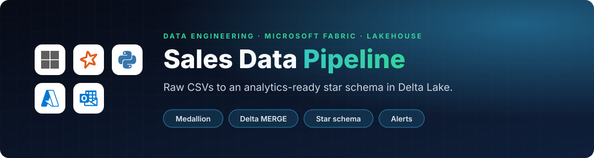
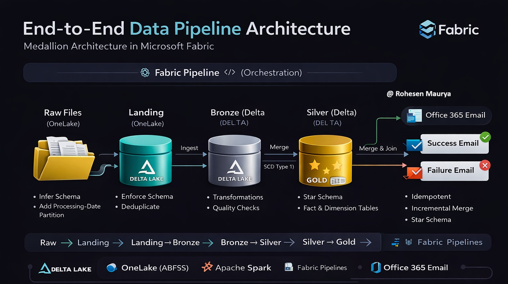

<p align="center">
  
</p>

<p align="center">
  
  
  
  
  
</p>

<p align="center">
  <a href="#%EF%B8%8F-architecture">Architecture</a> ·
  <a href="#-pipeline-orchestration">Orchestration</a> ·
  <a href="#-notebooks-breakdown">Notebooks</a> ·
  <a href="#-data-model-gold-layer">Data model</a> ·
  <a href="#-screenshots">Screenshots</a>
</p>

---

> An **end-to-end data engineering pipeline** built using **Microsoft Fabric**, **Apache Spark**, and **Delta Lake** following a **Medallion Architecture (Raw → Landing → Bronze → Silver → Gold)**.

The pipeline ingests raw CSV sales data, applies data quality checks and transformations, and produces **analytics-ready fact and dimension tables**. The entire flow is orchestrated using **Fabric Pipelines** with success and failure notifications.

## 🏗️ Architecture

<p align="center">
  
</p>

<table>
<tr>
<td width="45%" valign="top">

**Medallion layers**

```text
Raw Files
   ↓
Landing (Partitioned by Processing_Date)
   ↓
Bronze (Delta | Deduplicated & Incremental)
   ↓
Silver (Business Transformations)
   ↓
Gold (Star Schema: Dimensions + Fact)
```

</td>
<td width="55%" valign="top">

**Technologies used**

| | |
|---|---|
| 🟦 | Microsoft Fabric |
| ⚡ | Apache Spark (PySpark & Spark SQL) |
| 🔺 | Delta Lake |
| ☁️ | OneLake (ABFSS) |
| 🔁 | Fabric Pipelines (Orchestration) |
| 📧 | Office 365 Email (Notifications) |

</td>
</tr>
</table>

## 🔄 Pipeline Orchestration

The Fabric pipeline executes the following steps sequentially:

| Step | Activity |
|:-:|---|
| 1 | **Raw → Landing** |
| 2 | **Landing → Bronze** |
| 3 | **Bronze → Silver** |
| 4 | **Silver → Gold** |
| 5 | **Email Notification (Success / Failure)** |

✔ Fully automated &nbsp;·&nbsp; ✔ Idempotent &nbsp;·&nbsp; ✔ Production-ready

## 📁 Notebooks Breakdown

<details open>
<summary><b>1️⃣ Raw → Landing</b></summary>

**Purpose**
- Read raw CSV files from OneLake
- Add `Processing_Date`
- Store data in a partitioned Landing zone

**Key features**
- Schema inference
- Partitioning by `Processing_Date`
- Data availability check

```python
df_new = df.withColumn('Processing_Date', lit(processed_date))

df_new.write \
    .format('csv') \
    .option("header", "true") \
    .mode("append") \
    .partitionBy("Processing_Date") \
    .save(".../Files/Landing")
```

</details>

<details>
<summary><b>2️⃣ Landing → Bronze</b></summary>

**Purpose**
- Enforce schema
- Deduplicate records
- Perform incremental UPSERT into Delta Bronze table

**Key features**
- Explicit schema definition
- Deterministic deduplication using `ROW_NUMBER`
- Delta `MERGE` (SCD Type 1)

```sql
MERGE INTO tblsales_bronze
USING t_new_data_dedup
ON Order_ID AND Customer_ID
```

✔ Handles late-arriving data<br>
✔ Prevents duplicate key conflicts

</details>

<details>
<summary><b>3️⃣ Bronze → Silver (Transformations)</b></summary>

**Purpose**
- Apply business logic
- Improve data quality
- Create enriched metrics

**Transformations**
- Remove null keys
- Remove duplicates
- Calculate delivery days
- Calculate profit margin

```python
df_days = df.withColumn(
    'Delivery_Days',
    (col('Ship_Date') - col('Order_Date')).cast('int')
)

df_final = df_days.withColumn(
    'Profit_Margin',
    col('Profit') / col('Sales')
)
```

**Silver table:** `tblsales_silver` · Delta format · Incremental MERGE

</details>

<details>
<summary><b>4️⃣ Silver → Gold (Star Schema)</b></summary>

**🟡 Dimension tables:** `Dim_Customer`, `Dim_Product`

✔ Deduplicated by business key<br>
✔ SCD Type 1<br>
✔ Deterministic logic using Window functions

```python
Window.partitionBy("Customer_ID")
```

**🔵 Fact table:** `Fact_Sales`

✔ Incremental MERGE<br>
✔ Analytics-ready<br>
✔ Fully conformed dimensions

</details>

<details>
<summary><b>5️⃣ Monitoring & Metrics</b></summary>

After every MERGE:
- Rows inserted
- Rows updated
- Rows deleted
- Total affected rows

```python
history_df = delta_table.history(1)
```

</details>

## 📈 Key Design Decisions

| Decision | Why |
|---|---|
| **Delta Lake MERGE** | Incremental processing |
| **Window-based deduplication** | Avoids ambiguous MERGE errors |
| **Partition pruning** | Using `processing_date` |
| **Idempotent pipelines** | Safe re-runs |
| **Separation of concerns** | Raw vs Bronze vs Silver vs Gold |

## 📬 Notifications

✅ Success email on a successful pipeline run · ❌ Failure email on pipeline failure, implemented using the **Office 365 Email activity** in Fabric Pipelines.

## 🧪 Data Model (Gold Layer)

**Star schema**

```text
            Dim_Customer
                  |
                  |
Dim_Product — Fact_Sales
```

Optimized for BI tools, reporting and analytics workloads.

## 📸 Screenshots

| 🔁 Pipeline run (all activities succeeded) |
|:--:|
|  |

| 🧩 Semantic model (star schema) | 📊 Sales report |
|:--:|:--:|
|  |  |

| ✅ Success email | ❌ Failure email |
|:--:|:--:|
|  |  |

## 🧠 Learnings & Highlights

- Real-world Delta MERGE pitfalls and fixes
- Source deduplication before MERGE
- Dimension vs Fact modeling rules
- Fabric OneLake + Delta best practices
- End-to-end orchestration in Microsoft Fabric

## 📌 Future Enhancements

- SCD Type 2 for dimensions
- Data Quality framework
- Parameterized pipelines
- Incremental file ingestion
- Power BI semantic model

## 👤 Author

**Rohesen Maurya**: Data Engineer | Microsoft Fabric | Spark | Delta Lake ([@Rohesen](https://github.com/Rohesen))

<p align="center"><sub>If this project helped you, a ⭐ is appreciated</sub></p>
